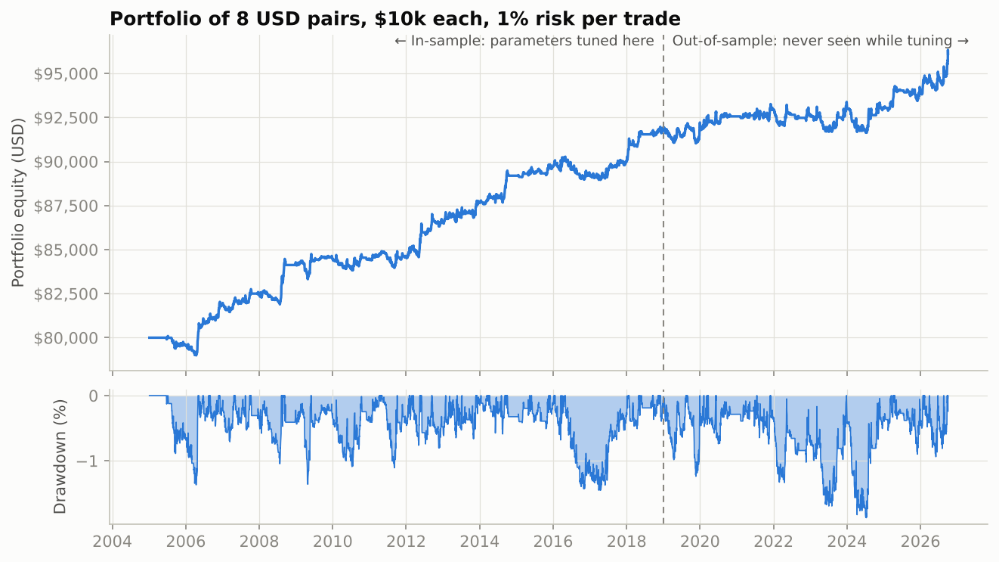
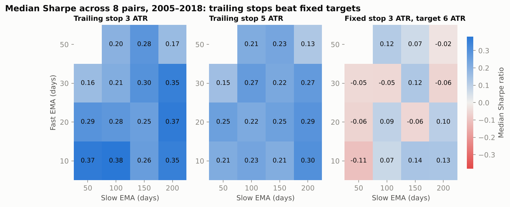
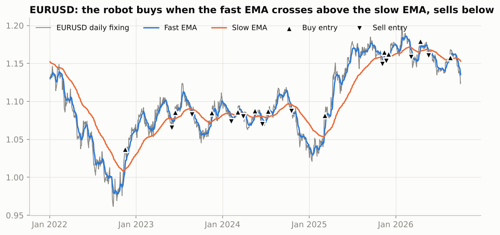

# 🤖 Forex Trading Robot: EMA Crossover with ATR Trailing Stops

A rules-based trading robot for 8 major USD currency pairs, written in Python. It includes a bar-by-bar backtest engine, a parameter search, and an **out-of-sample test** that shows how the rules perform on data they were never tuned on.

The real question is not "can I write a bot?" but "**does the edge survive outside the data it was fitted on?**". This project answers that with evidence.



---

## The trading rules

| Step | Rule |
|---|---|
| **Signal** | Go **long** when the 10-day EMA crosses above the 100-day EMA. Go **short** when it crosses below. |
| **Entry** | At the next bar's open, after the signal bar has closed. No look-ahead. |
| **Initial stop** | 3 × ATR(14) from entry. |
| **Exit** | The stop **trails** 3 ATR behind each close and only ever tightens. An opposite crossover closes the trade and flips it. |
| **Position size** | Sized so that hitting the stop loses **1% of equity**. Capped at 10:1 leverage and rounded down to micro lots (1,000 units). |
| **Costs** | Retail spreads per pair (1.0 pip EUR/USD up to 150 pips USD/ZAR), half paid on entry and half on exit. |

The 10/100 periods and the trailing stop were **not hand-picked**. They are the best of 45 combinations tested on 2005–2018 data only.

## Results

### 1. Tuning (2005–2018): trailing stops beat fixed targets



The grid scores each setting by the **median Sharpe across all 8 pairs**. The median rewards settings that work broadly, not ones that happen to suit a single pair.

The clearest finding is about exits, not moving-average lengths. Trailing stops are positive in all 30 of their combinations. Fixed take-profit targets cut the winners short and land between −0.11 and +0.14, with only 8 of 15 above zero.

### 2. The honest test: 2019 – Oct 2026, never seen during tuning

| Portfolio (8 pairs × $10k) | Sharpe | Total return | Max drawdown | Trades | Win rate | Profit factor | Avg trade |
|---|---|---|---|---|---|---|---|
| In-sample 2005–2018 | 0.83 | +14.9% | −1.5% | 491 | 42.6% | 1.65 | +0.25R |
| **Out-of-sample 2019–2026** | **0.38** | **+4.1%** | **−1.8%** | **326** | **38.0%** | **1.19** | **+0.07R** |
| Out-of-sample, spreads doubled | 0.32 | +3.4% | −2.1% | 326 | 37.4% | 1.14 | +0.05R |

<details><summary>Out-of-sample results by pair</summary>

| Pair | Return | Sharpe | Max DD | Trades | Win rate | Profit factor |
|---|---|---|---|---|---|---|
| NZD/USD | +13.9% | 0.56 | −5.7% | 50 | 46.0% | 1.67 |
| AUD/USD | +11.7% | 0.49 | −6.5% | 37 | 40.5% | 1.91 |
| GBP/USD | +9.5% | 0.42 | −3.8% | 43 | 41.9% | 1.54 |
| USD/CHF | +3.5% | 0.17 | −9.3% | 39 | 33.3% | 1.24 |
| USD/CAD | +3.5% | 0.17 | −6.9% | 49 | 38.8% | 1.09 |
| EUR/USD | −0.1% | 0.01 | −6.3% | 33 | 42.4% | 0.73 |
| USD/JPY | −0.9% | −0.04 | −5.3% | 24 | 29.2% | 0.91 |
| USD/ZAR | −8.6% | −0.39 | −14.3% | 51 | 29.4% | 0.52 |
</details>

**What this shows:**
- **The edge roughly halved out-of-sample.** Sharpe fell from 0.83 to 0.38. This is the normal decay from fitting parameters to history, and it is why an in-sample backtest alone is never enough evidence.
- **It stayed positive, even with doubled costs.** Trend-following on daily FX is a thin but real effect. Most of the profit comes from a few long trends, which is why the win rate sits below 40%.
- **Diversification does the heavy lifting.** Single pairs saw drawdowns of 4–14%. The 8-pair portfolio's worst drawdown was under 2%.
- **USD/ZAR is the weak spot.** Its spread is high and its moves are jumpy. A live version should drop it or demand a wider stop.
- **Returns are small because risk is small.** Each trade risks 1% of one $10k sub-account, which is 0.125% of the $80k portfolio. Returns and drawdowns scale roughly with the `--risk` setting.

### 3. What the robot does on a chart



EUR/USD was the hardest pair out-of-sample, and the chart shows why. The 2023–24 range produced 11 small, choppy trades. In the March 2025 breakout, the 3-ATR trailing stop knocked the robot out after three weeks (−0.2R). The rules only re-enter on a fresh crossover, so it then sat out the rest of a ~10% rally. A **re-entry rule** (rejoin the trend after a stop-out while the EMAs still agree) is the most promising next improvement.

## ⚡ Scalping lab: can $10k become $1M in a year?

The [`scalping/`](scalping/) folder tests **8 classic EUR/USD scalping setups** on 2.6 million real 1-minute bars (2019–2025), with realistic costs and a 2023–2025 out-of-sample test. It then simulates 10,000 one-year paths from $10k at aggressive leverage.

- **No true scalp survived costs out-of-sample.** The median 1-minute candle (1.1 pips) is about the size of one round-trip cost (1.0 pip).
- **The one setup with an edge, a London breakout, is really a 6-hour day trade.**
- **$1M in a year happened in 0.07% of simulated years, against a 46% chance of losing 90%+.** It would take a Sharpe ratio of about 3.0; the best setup managed 0.17.

[Read the full study →](scalping/)

---

## How to run it

```bash
cd Forex-Trading-Bot
pip install -r requirements.txt

python bot.py backtest                         # all 8 pairs, 2005 to today
python bot.py backtest --pairs EURUSD GBPUSD --fast 20 --slow 200 --start 2019-01-01
python bot.py optimize                         # rebuild the grid, the out-of-sample tables and the charts in results/
python bot.py signals --equity 10000           # current positions, stops and next actions
python -m pytest                               # 25 tests on both engines
```

Example `signals` output (data to 2 Oct 2026):

```
  pair      as_of     close trend position      since    entry      stop  units        next_action
EURUSD 2026-10-02   1.12587  down    SHORT 2026-09-18  1.14779   1.13202 16,000               hold
USDJPY 2026-10-02 157.81000  down     flat                                        wait for crossover
USDCAD 2026-10-02   1.42530    up     LONG 2026-09-21  1.40088   1.41671 15,000               hold
```

**Use your own broker data.** Export daily bars from MetaTrader 5 (*View → Symbols → Bars tab → Request → Export Bars*) and pass the file with `--csv`. Real intraday highs and lows make the stop simulation more accurate:

```bash
python bot.py backtest --csv EURUSD_D1.csv --pairs EURUSD
```

**Refresh the data:** `python data/build_dataset.py`

## Project structure

```
Forex-Trading-Bot/
├── bot.py                  # CLI: backtest · optimize · signals
├── forexbot/
│   ├── data.py             # data loaders (bundled Fed data, MT5/broker CSV), pair specs & spreads
│   ├── indicators.py       # EMA, SMA, ATR (Wilder)
│   ├── strategy.py         # crossover signal logic
│   ├── backtest.py         # bar-by-bar engine: fills, stops, sizing, costs, P&L in USD
│   ├── portfolio.py        # multi-pair runs, grid search, in/out-of-sample split
│   ├── metrics.py          # CAGR, Sharpe, drawdown, profit factor, expectancy (R)
│   └── report.py           # charts
├── data/
│   ├── fx_daily.csv        # 5,451 days × 8 pairs, Jan 2005 – Oct 2026
│   └── build_dataset.py
├── results/                # charts + CSVs written by `bot.py optimize`
├── scalping/               # 1-minute scalping lab + $10k→$1M Monte Carlo
└── tests/test_bot.py
```

## Data & assumptions

- **Source:** Federal Reserve H.10 daily noon buying rates in New York, via [datasets/exchange-rates](https://github.com/datasets/exchange-rates) (public domain). These are real market rates, not sample data. Pairs are converted to market convention, e.g. EUR/USD rather than EUR per USD.
- **One price per day.** FX trades around the clock, so each bar opens at the previous fixing and spans the move to the next one. Real intraday ranges are wider, so stops would trigger somewhat more often in live trading. Re-run with broker OHLC data via `--csv` to measure the difference.
- **Not modelled:** overnight swap/financing (it matters for high-carry pairs like USD/ZAR), slippage beyond the spread, and broker margin rules.
- **Guarding against overfitting:** parameters were chosen on 2005–2018 data only, scored by the cross-pair median, and tested once on 2019–2026. Costs were stress-tested at double the spread.

## Skills demonstrated

Python (pandas, NumPy, matplotlib) · event-driven simulation · avoiding look-ahead bias · time-series feature engineering · walk-forward / out-of-sample validation · risk-based position sizing · performance analytics (Sharpe, drawdown, profit factor, R-multiples) · unit testing with pytest · reproducible CLI tooling.

> ⚠️ **Not financial advice.** This is a research and portfolio project. Past performance, especially in a backtest, does not predict future results. Leveraged FX trading can lose more than your deposit. Paper-trade on a demo account before risking real money.
