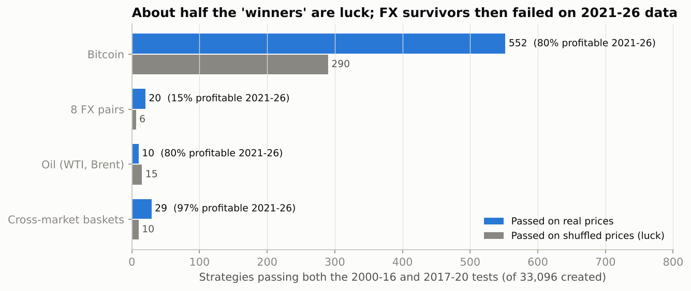
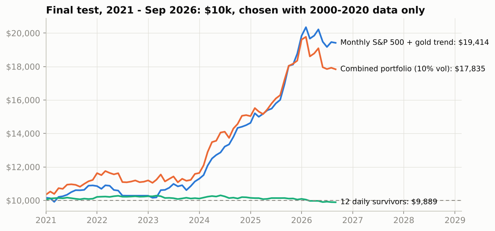
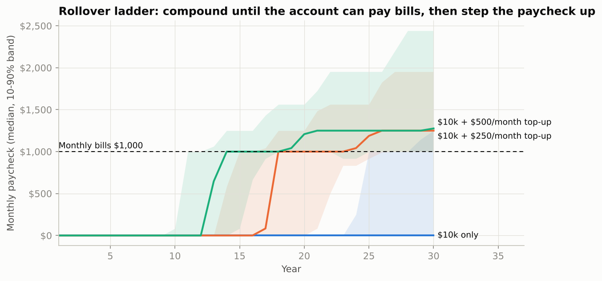
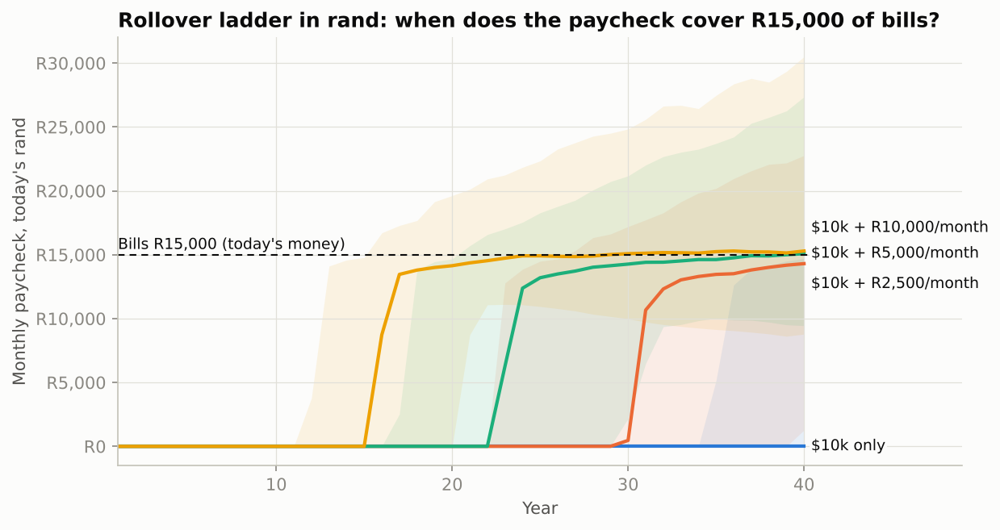

# 🏭 Strategy Factory: Can $10k Pay the Monthly Bills?

The goal: create new trading strategies, in any market, until something passes, and see whether a **$10,000 account can pay rent, groceries and bills every month**. Bet size increases as the account grows (a "rollover" plan).

The factory **generated 33,096 strategies** from 14 building blocks. It tested them on 11 daily markets (8 currency pairs, Bitcoin, WTI and Brent oil) and on monthly S&P 500 and gold. Every strategy then had to survive the same three-stage filter a quant desk uses.

**The verdict:**
- **Something does pass.** A simple monthly trend rule on stocks and gold earned **12.2% a year** on 2021–2026 data it never saw.
- **$10k can't pay $1,000 of bills a month.** It sustainably pays about **$60–95 a month**.
- **The rollover ladder works, but slowly.** It reaches a $1,000 paycheck in about **10–12 years** with a $500/month top-up, or **22–26 years** from the $10k alone at 1.5–2× leverage.

---

## 1. How strategies were created and filtered

**Building blocks.** Each strategy combines one signal, an optional filter, a direction and an optional holding limit, all with random parameters:

| Type | Signal families |
|---|---|
| Trend | moving-average trend, MA crossover, time-series momentum, Donchian breakout, near 52-week high |
| Reversal | z-score reversion, RSI reversion, short-term reversal |
| Shocks | big-move follow/fade, VIX-spike "buy the fear" |
| Regime | VIX below/above its average (risk-on/off) |
| Calendar | day-of-week, turn-of-month |
| Cross-market | rank all 11 markets by momentum (or reversal), long the strongest, short the weakest |
| **Filters** | trend filter, low/high volatility regime, calm/fearful VIX |
| **Modes** | long-only, short-only, long-short; optional max holding 5/10/21 days |

**The filter**, with rules fixed before any results were seen:

| Stage | Period | Rule |
|---|---|---|
| 1. Discover | 2000–2016 | net Sharpe ≥ 0.5, ≥ 10 trades, in the market ≥ 5% of days |
| 2. Confirm | 2017–2020 | net Sharpe ≥ 0.5 again |
| 3. **Final test** | **2021 – Oct 2026** | run once; never used to choose anything |
| Luck control | all | the same 33,096 strategies run on **shuffled** prices: same returns, random order, so no pattern can exist |

**Realism:**
- Positions are decided at each close and earn the next day's move.
- Every strategy pays trading costs plus a yearly holding cost: FX 1 bp/trade + 1%/yr, USD/ZAR 5 bp + 2%, oil 3 bp + 4% roll, Bitcoin 15 bp + 5% funding.
- The VIX is lagged a day, because it settles after the FX fixings.
- A look-ahead test confirmed that **0 of 1,190** random strategies can see the future.

## 2. What survived



| Markets | Strategies tested | Passed (real) | Passed (luck) | Profitable 2021–26 |
|---|---|---|---|---|
| Bitcoin | 3,000 | 552 | 290 | 80% (but median Sharpe 0.25 vs 0.50 for just holding BTC) |
| 8 FX pairs | 24,000 | 20 | 6 | **15%** |
| Oil (WTI, Brent) | 6,000 | 10 | 15 | 80% |
| Cross-market baskets | 96 | 29 | 10 | **97%** |
| **Total** | **33,096** | **611** | **321** | 79% |

- **About half of all "winners" are what pure luck plus market drift produce.** The shuffled data kept each market's drift, so Bitcoin's long-run rise let hundreds of random long-Bitcoin rules pass even with no pattern present.
- **Currencies:** of 24,000 FX strategies, 20 passed and only 3 of those made money on 2021–26 data. **Daily FX timing showed no edge at all.**
- **Mean reversion failed** (z-score, RSI, short-term reversal). Fewer passed on real data than on shuffled data.
- **What beat luck:** cross-market momentum (29 vs 8), the near-52-week-high rule (92 vs 9), turn-of-month (123 vs 38) and day-of-week (20 vs 1).

## 3. The final test: one portfolio, built only from pre-2021 data

The portfolio rules (`portfolio.py`) were fixed in advance:
- **Daily sleeve:** the 12 most robust daily survivors, kept only if their returns correlate below 0.5 with each other, at most 2 per market, weighted by inverse volatility.
- **Monthly sleeve:** the best monthly survivor, a **10-month trend rule on S&P 500 + gold**. Hold each one while it's above its 10-month average, otherwise cash.
- **Combined:** the two sleeves at equal risk, scaled to 10% volatility.



| 2021 – Sep 2026, never seen | Return / yr | Sharpe | Max drawdown | $10k became |
|---|---|---|---|---|
| 12 daily survivors (shown unlevered) | −0.2% | −0.13 | | $9,889 |
| **Monthly S&P 500 + gold trend** | **12.2%** | **1.63** | | **$19,414** |
| Combined portfolio, 10% vol | 10.6% | 1.21 | −9.8% | $17,835 |
| *Combined, 2000–2020 (data it was picked on)* | *21.3%* | *1.99* | *−7.0%* | |

**The lesson:** the 12 daily strategies cleared two hurdles with Sharpe ratios of 0.6–2.3 and then **failed on new data**. Only the simplest idea, trend-following on two assets that rise over the long run, held up. The combined portfolio did well *because of* the monthly sleeve, not the daily one.

**What I did not do:** the cross-market momentum baskets did well in 2021–26 (97% profitable), but the pre-set rules didn't select them. Adding them now, after seeing the final test, would turn the final test into another tuning round. So they stay out.

## 4. Can it pay the bills? The rollover plan

The surviving strategy (10-month trend on S&P 500 + gold) earned **9.2% a year over 1972–2026**, with 8.6% volatility and a worst drawdown of −16%. It worked in every era: 9.7% (1972–99), 9.0% (2000–12), 5.8% (2013–20) and 12.2% (2021–26).

`income.py` replays that record as 3,000 random futures, in 12-month blocks, starting from **$10,000** with **$1,000 a month of bills**:

| Plan | Leverage | Result |
|---|---|---|
| **Withdraw $1,000/month from day one** | any | Bills fully paid for a median of **10 months**; the account runs dry in 100% of simulated futures |
| **Pay 0.6% of the account each month** | 1× | ~$60/month in year 1, ~$70 by year 10 |
| | 2× | ~$61/month in year 1, ~$95 by year 10 (5% chance of dropping below $5k) |
| **Rollover ladder, $10k only** | 1× | Median: still compounding after 30 years |
| | 1.5× | Paycheck covers the bills after **26 years** |
| | 2× | **22 years** |
| **Ladder + $250/month top-up** | 1× / 1.5× / 2× | **17 / 15 / 13.5 years** |
| **Ladder + $500/month top-up** | 1× / 1.5× / 2× | **12 / 11 / 10 years** (47% chance within 10 years at 2×) |

The rollover ladder works like this:
1. Reinvest everything until the account can safely pay the bills.
2. At a 0.6%/month payout, $1,000 of bills needs **$166,667**.
3. From then on, raise the paycheck 25% each time the account grows 25%, and cut it only if the account falls 20% below its level.



**Why it takes years:**
- **The safe payout is small.** A strategy earning about 9% a year can pay out about 7% a year (0.6%/month) without shrinking. On $10k that's $60 a month.
- **Leverage helps only a little.** It speeds compounding, but the drawdowns grow in proportion.
- **Drawdowns are understated.** These simulations run on monthly *average* prices, which hide part of each drawdown. Real drawdowns at 2× would be deeper than shown.

### In rand: R15,000 a month of bills

`rand_plan.py` reruns the plan for **R15,000 a month**:
- **Conversion:** R15,000 is $900 at R16.67/$, the latest rate in the data (2 Oct 2026).
- **Inflation:** the bills grow **3% a year in dollar terms**, which is SA inflation (~5–6%) less the rand's usual yearly slide against the dollar.
- **Payout rate:** with inflation included, the safe payout falls to **0.5% a month** (about 9% return minus 3% inflation). Covering the bills therefore needs about **R3 million** in today's money.

All rand figures are in today's money.

| Starting with | Monthly top-up | Bills covered after (median) |
|---|---|---|
| $10,000 (≈R167,000) | none | not within 40 years |
| | R2,500 | **30 years** |
| | R5,000 | **23 years** |
| | R10,000 | **15 years** |
| R10,000 | none | not within 40 years |
| | R2,500 | 36 years |
| | R5,000 | 26 years |
| | R10,000 | 17 years |



| Without the ladder | $10,000 start | R10,000 start |
|---|---|---|
| Take R15,000/month from day one | lasts **11 months** | can't pay one month |
| Pay out 0.5% a month | **≈R830/month** | **≈R50/month** |

**What this shows:**
- **The monthly top-up decides the timeline, not the starting amount.** Starting with $10k instead of R10k saves only 2–6 years.
- **Borrowing doesn't help in rand.** Borrowing costs about prime (~10%), so 1.5× leverage with an R5,000 top-up is *slower* (23.4 years) than no leverage (22.6 years).
- **The paycheck lags inflation between steps.** It rises in 25% steps while bills rise every year, so the paycheck runs slightly behind inflation between steps.

## 5. Honest caveats

- **Monthly averages.** S&P and gold monthly data are monthly averages. I skip a month between signal and trade to remove the resulting look-ahead, but volatility and drawdowns are still understated. Real Sharpe ratios are probably about 20% lower.
- **Cash earns 0% here.** In reality, T-bills paid 0–5%, which would help the trend rule while it sits in cash.
- **Dividends after mid-2023.** Shiller dividends stop then; the last value is carried forward.
- **Left out:** natural gas (its spot price isn't tradable) and bonds (the yield series ends in 2023).
- **Not modelled:** taxes and slippage beyond the cost assumptions.
- **Unavailable data:** Yahoo and other market-data APIs were blocked in this environment. Daily stock and ETF data would allow a richer stock sleeve.

## Run it

```bash
pip install -r requirements.txt
python -m factory.run      # creates + tests 33,096 strategies, real and shuffled (~13 min; downloads ~170 MB once)
python -m factory.report   # portfolio, final test, income plans, charts
python -m factory.rand_plan  # the same plans for R15,000/month of bills, in today's rand
```

**Data sources** (pinned commits, downloaded on demand, not redistributed):
- Fed H.10 FX rates, EIA oil spot prices, CBOE VIX, Shiller S&P 500 and gold prices: [github.com/datasets](https://github.com/datasets)
- Bitcoin: *Zielak (mczielinski), Bitcoin Historical Data, Kaggle* (CC BY-SA 4.0) and *Bitstamp BTC/USD minute data, [github.com/ff137/bitstamp-btcusd-minute-data](https://github.com/ff137/bitstamp-btcusd-minute-data)* (CC BY 4.0)

> ⚠️ Research project, not financial advice. Leverage magnifies losses as much as gains. Past results, especially in backtests, do not predict future returns.
