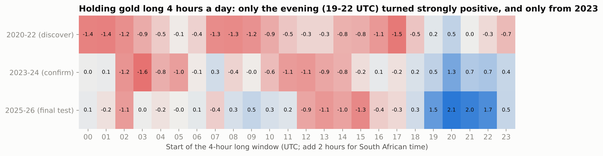
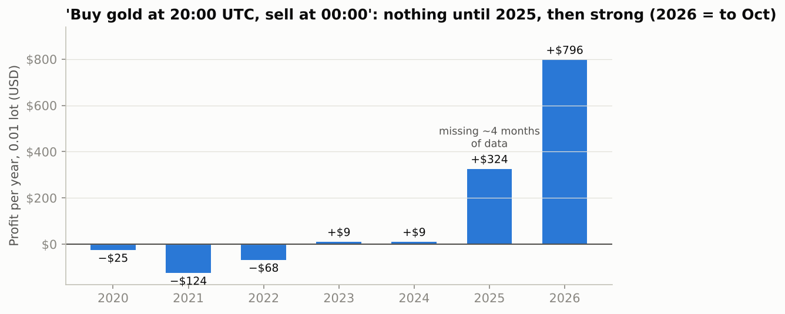

# 🏭🥇 Gold-Only Strategy Factory

A trader wanted to focus on **gold (XAU/USD) only**. The factory therefore **generated 3,277 new rules for gold**. They were tested on 15-minute, 1-hour, 4-hour and daily charts built from 2.3 million 1-minute bars (Jan 2020 – Oct 2026). Each rule faced three separate periods plus a luck control.

## The verdict

- **Gold showed no timing edge beyond luck.** **33** rules passed both early tests on real prices, but **58** passed on *shuffled* prices, where any real pattern is destroyed and only luck and gold's rise remain.
- **Most survivors then weakened in the final test.** On 2025–26 their median Sharpe was 0.47, below simply holding gold (0.63, about +15% a year). Gold more than doubled over the period, so most rules that "worked" were long gold.
- **One pattern stands out: gold tends to rise in the evening, roughly 19:00–23:00 UTC (21:00–01:00 South African time).** But it only became profitable from 2023, and after realistic costs only from 2025.

## 1. How the rules were created and tested

- **Rule families:**
  - the factory's trend, momentum, breakout, mean-reversion and volatility-shock blocks, with random parameters, filters, long/short modes and holding limits;
  - calendar rules on the daily chart;
  - **a new time-of-day family**: hold gold long or short from a given UTC hour for 1, 2, 4 or 8 hours every weekday (384 rules).
- **Three periods:** discover **2020–22** and confirm **2023–24**, each needing net Sharpe ≥ 0.5, at least 10 trades, and at least 5% time in the market. Then a one-time **final test, 2025 – Oct 2026**.
- **Luck control:** the same rules on shuffled returns, keeping gold's overall rise but destroying any timing. **Benchmark:** holding gold.
- **Costs:** $0.40 per ounce per round trip, plus 4% a year financing.
- **Data fixes** (see [`gold_rsi/`](../gold_rsi/)):
  - the archive's 2020 – Sep 2025 timestamps were broker server time, converted to UTC;
  - four holes in 2025 (about 4 months in total) are respected: no position crosses one, and every rule restarts after it.
- **Look-ahead check:** 0 of 150 sampled rules can see the future.

## 2. What survived

| | Tested | Passed (real) | Passed (luck) |
|---|---|---|---|
| All rules | 3,277 | **33** | **58** |
| Daily chart | 847 | 17 | 11 |
| 4-hour chart | 682 | 9 | 44 |
| 1-hour + 15-minute | 1,748 | 7 | 3 |
| Time-of-day rules | 384 | 1 | 0 |

- **Survivors were mostly long gold** (21 of 33 long-only).
- **In the final test,** 11 of 33 beat holding gold on Sharpe. Most of those were in the market only 3–10% of the time and earned 1–5% a year.
- **The one strong survivor** was "long gold 20:00–24:00 UTC": Sharpe 0.51 → 1.28 → 2.13 across the three periods.

## 3. The evening pattern



Each cell is the Sharpe ratio of holding gold long for 4 hours a day starting at that UTC hour (factory costs).
- **Evening starts (19:00–22:00 UTC)** became strongly positive in 2023–24 and 2025–26, and that held across neighbouring hours and window lengths, so it isn't one lucky setting.
- **London and New York hours (12:00–17:00 UTC)** lost money in all three periods.
- **In 2020–22, the evening was flat** (−0.3 to +0.5).

**The rule in dollars**, buying at 20:00 UTC and selling at 00:00 every weekday at **0.01 lot**. Costs are $0.40 spread and commission plus **one full night's swap** (about 4% a year), because the window crosses the 21:00/22:00 UTC rollover when brokers charge it:



| 0.01 lot | 2020–22 | 2023–24 | 2025 – Oct 2026 |
|---|---|---|---|
| Total | **−$217** | **+$18** | **+$1,121** |
| Average month | −$6 | +$1 | **+$53** |
| Profitable months | 31% | 42% | 62% |
| Worst month | −$56 | −$16 | −$111 |
| Worst drawdown | −$277 | −$48 | −$269 |

Across all 1,296 trades it made +$0.71 per trade on average, with a 44% win rate.

**How to read this:**
- **The evening effect is real in the data, but young.** It made money only in 2025–26. That includes 2026, when the rule earned **+$796 while gold itself fell**, so it isn't simply gold's rise.
- **Before that it lost or broke even.** About five years of nothing and under two years of profit suggests a recent regime, not a permanent law. A plausible explanation is strong Asian buying while US markets close and Asia opens, but this study can't prove that.
- **On a R10,000 account (about $600) at 0.01 lot:**
  - 2025–26 averaged about **R880 a month**, but with a worst drawdown of about **R4,500** (45% of the account).
  - In 2020–22 the same rule lost about **R100 a month**.

## 4. Lot sizes and how much capital you need

Profit, loss and drawdown all scale exactly with lot size. 0.01 lot = 1 ounce, 1.00 lot = 100 ounces.

The capital an account needs is set by **the worst losing stretch, −$304 per 0.01 lot** (March 2020 → April 2023, three years below its previous high), not by margin. Margin is small: about $41 per 0.01 lot at 1:100 leverage.

**Recommended capital = 4 × the worst stretch: $1,217 (≈R20,300) per 0.01 lot.** A repeat of the worst stretch would then cost about 25% of the account.

| Lots | Avg month, 2020–26 | Avg month, 2025–26 pace | Worst month | Worst single night | Worst losing stretch | **Recommended capital** |
|---|---|---|---|---|---|---|
| 0.01 | +$11 (R190) | +$51 (R850) | −$111 | −$127 | −$304 (R5,100) | **$1,217 (R20,300)** |
| 0.02 | +$23 (R380) | +$102 (R1,700) | −$221 | −$254 | −$609 | **$2,435 (R40,600)** |
| 0.05 | +$57 (R950) | +$255 (R4,250) | −$553 | −$634 | −$1,522 | **$6,087 (R101,500)** |
| 0.10 | +$114 (R1,900) | +$510 (R8,500) | −$1,107 | −$1,268 | −$3,044 | **$12,174 (R203,000)** |
| 0.20 | +$228 (R3,800) | +$1,019 (R17,000) | −$2,214 | −$2,536 | −$6,087 | **$24,349 (R406,000)** |
| 0.50 | +$569 (R9,500) | +$2,548 (R42,500) | −$5,534 | −$6,341 | −$15,218 | **$60,871 (R1.0M)** |
| 1.00 | +$1,138 (R19,000) | +$5,095 (R84,900) | −$11,069 | −$12,681 | −$30,436 | **$121,743 (R2.0M)** |

**Other capital levels per 0.01 lot:**
- **Aggressive, $609 (≈R10,100):** a repeat of the worst stretch costs about **half the account**.
- **Conservative, $2,435 (≈R40,600):** survives a stretch **twice as bad** as any seen, at a 25% loss.

**What R15,000 a month of bills would take:**

| If the rule keeps earning… | Lot size needed | Recommended capital |
|---|---|---|
| …at the 2025–26 pace ($51 per 0.01 lot a month) | 0.18 lot | **≈ $21,500 (R358,000)** |
| …at its 2020–26 average ($11 per 0.01 lot a month) | 0.79 lot | **≈ $96,000 (R1.6 million)** |

**With R10,000 (≈ $600):**
- **Maximum size is 0.01 lot**, and that's already the aggressive level.
- **Expected income:** about R190 a month at the long-run average, or about R850 a month if the 2025–26 pace continues.
- **Risk:** a repeat of the 2020–23 stretch would take about half the account.

**Losing years happen.** Shuffling whole months of real results into 20,000 random 12-month sequences gives a **33% chance of a losing year** using all years, and **5%** using only 2025–26. This shuffle breaks up multi-year losing streaks like 2020–23, so it understates the risk. Plan around the real worst stretch, not the shuffle.

## 5. Before using it

1. **Forward-test it on a demo account** for at least 2–3 months: buy 0.01 lot at 20:00 UTC (22:00 SAST) and close at 00:00 UTC (02:00 SAST) on weekdays.
2. **Check your broker's swap.** The cost model charges one full night of financing per trade. A swap-free account, or a broker with a smaller gold swap, would improve results.
3. **Never risk money you need for bills.** Even in its good period, the worst month lost $111 per 0.01 lot.

## Run it

```bash
python -m gold_factory.run      # 3,277 rules, real + shuffled (~5 min; gold data from gold_rsi.lab)
python -m gold_factory.report   # heatmap, evening-rule trades and yearly chart
python -m gold_factory.sizing   # lot sizes, capital and loss odds -> results/evening_rule_sizing.csv
python -m pytest tests/test_gold_factory.py
```

> ⚠️ Research project, not financial advice.
