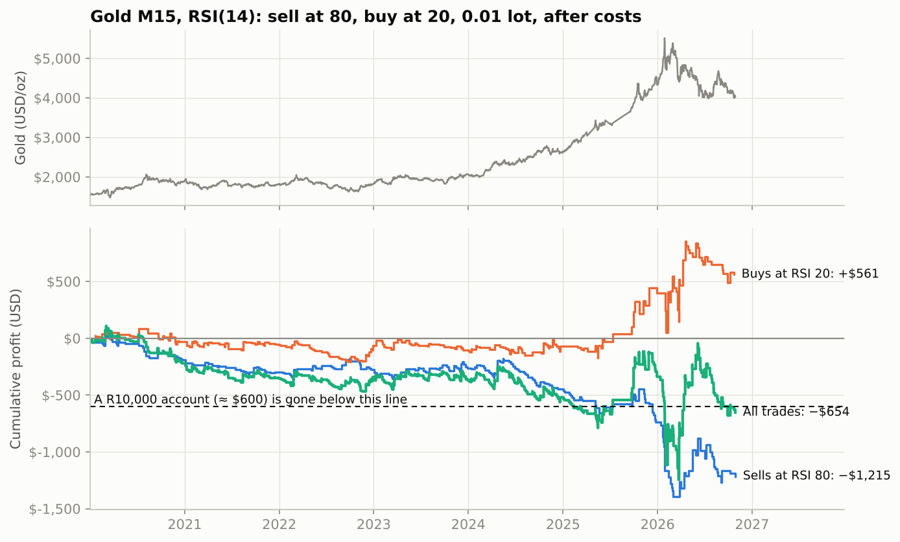
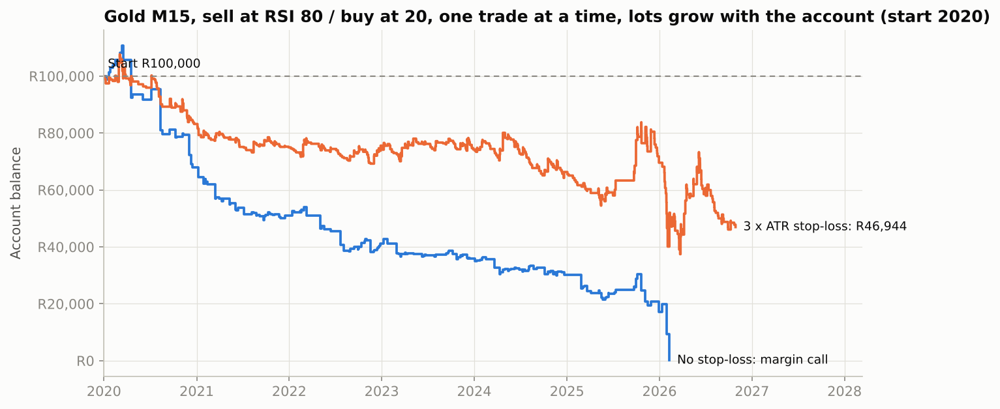

# 🥇 Gold RSI 80/20: "Sell at 80, Buy at 20"

A test of a trader's own MetaTrader 5 rule on gold:

> **XAU/USD, 15-minute chart, RSI(14): sell when RSI reaches 80, buy when it reaches 20.** Trade size 0.01 lot (1 ounce, so a $1 move in gold = $1 of profit or loss).



## The verdict

| Trader's exact rule, 0.01 lot, after costs | 2020–2022 | 2023 – Oct 2026 |
|---|---|---|
| Trades | 220 | 329 |
| Result before costs | −$173 | +$4 |
| **Result after costs** | **−$354** | **−$300** |
| Sells at RSI 80 | −$288 | **−$927** |
| Buys at RSI 20 | −$66 | +$627 |

Over the whole period:
- **Total: −$654**, with only 37% of months profitable and an average of −$8 a month.
- **Biggest swings:** the best month made **+$421**, the worst lost **−$582**.
- **Worst drawdown: −$1,354.** A R10,000 account (about $600) at 0.01 lot would have been **wiped out by February 2025**.

**Why it loses:** RSI at 80 doesn't mean "too high". On gold it usually means "rising fast", and gold went from $1,528 to over $4,000 in this period. Selling every time RSI reached 80 meant selling into the strongest uptrend in gold's history. The buys at 20 made money only in 2023–26, when buying dips in that uptrend paid off, and they lost money in 2020–22. Before costs the rule roughly breaks even, so spreads and overnight financing turn it into a loss.

Big winning trades, like a $75 sell into a sharp drop, do happen. The rule's best month made $421. But over 82 months the losses outweighed them.

## One trade at a time, with compounding lot sizes

The trader's exact plan:
- **One trade at a time.** When RSI reaches 80, sell. Hold until RSI reaches 20, then close and buy. Hold until RSI reaches 80, then close and sell, and so on.
- **Compounding.** The lot size grows with the account.

`compound.py` simulates real accounts:
- **Sizing:** before each trade, lots = account ÷ R10,000 (aggressive) or ÷ R20,000 (recommended), × 0.01, never below 0.01.
- **Margin calls:** the open trade is marked to its worst price inside every 15-minute bar. If equity reaches the broker's stop-out level (50% margin level at 1:500), the account is closed.
- **Versions:** with no stop-loss (trades close only at the opposite signal), and with a 3 × ATR safety stop.
- **Coverage:** start capital R10,000, R100,000 or R1,000,000, and every start year from 2020 to 2025. That's 72 accounts.



| Start capital | No stop-loss | With 3 × ATR stop |
|---|---|---|
| **R10,000** | 12 of 12 margin-called (most within 1–2 years) | 12 of 12 margin-called (after 1–5 years) |
| **R100,000** | 8 of 12 margin-called; survivors end at R23,000–28,000 | all survive, ending at R17,000–75,000 |
| **R1,000,000** | aggressive: all 6 margin-called; recommended: end at R38,000–206,000 | end at R100,000–694,000 |

**Of 72 accounts, 38 were margin-called and none ended with more money than it started with.**
- **Compounding speeds up the losses.** It can't fix a rule that loses money on average. When the account grows, the next losing streak hits at the bigger size.
- **A stop-loss slows the bleeding but doesn't stop it.** Without one, a single sell held through a gold rally can wipe out the account. That happened in 2020, 2024 and January 2026.

## Every variation tested (48)

All variations were fixed in advance, on **M5, M15 and H1**:

| Choice | Options |
|---|---|
| Entry | **touch**: act when RSI reaches 80/20 (the trader's way) · **confirm**: wait for RSI to turn back out of the zone |
| Exit | **reverse**: hold until the opposite signal, then flip · **RSI 50** · **ATR stop 2 / target 2** · **ATR stop 2 / target 4** (the first two also have a 3 × ATR safety stop) |
| Filter | none · EMA(50) trend filter (sell only below the average, buy only above) |

**Result: 0 of 48 were profitable after costs in both periods.** The best combination (M5, confirm entry, RSI-50 exit) made +$0.38 per trade in 2023–26, but lost $0.78 per trade in 2020–22.

**The trend filter never fires.** RSI only reaches 80 after a sharp rise, which puts price *above* its 50 EMA, so "sell only below the EMA" can't happen. An extra check with a 200 EMA produced just 3 trades per period, all losers.

## How it was tested

- **Data:** 2.3 million 1-minute spot gold bars, 2 Jan 2020 – 28 Oct 2026, from [parshant65-lang/Gold-XAUUSD-1m-2020-2025-Historical-Data](https://github.com/parshant65-lang/Gold-XAUUSD-1m-2020-2025-Historical-Data), pinned to one commit and downloaded on demand. The archive doesn't state its source or licence, so I validated it:
  - Its monthly averages match an independent gold series to about 0.1%.
  - Every bar's high and low are consistent with its open and close.
  - The archive labels every timestamp as UTC, but files up to 30 Sep 2025 are actually in broker server time (EET/EEST, UTC+2/+3). There the daily break sits at 00:00 and the US jobs report at 15:30. These are converted to real UTC, which puts every jobs report at 12:30/13:30 UTC. RSI results on M5–H1 are identical either way.
  - It has **four holes in 2025** (10, 17, 26 and 68 days, about 4 months in total; visible as the straight line in the price chart). The data is split at every gap longer than 4 days: indicators restart after it, and no trade is held across it.
- **Indicators and fills:**
  - RSI(14) uses Wilder smoothing, like MT5.
  - Fills happen at the next bar's open.
  - If a bar touches both the stop and the target, the stop counts first. A gap through a level fills at the open.
- **Costs per round trip:** $0.40 per ounce of spread and commission (also tested at $0.20), plus overnight financing of 4% a year on the position's value.
- **Periods:** 2020–2022 first, 2023 onwards as the final test.

## Run it

```bash
python -m gold_rsi.lab       # downloads ~160 MB once, then all 48 combinations -> results/all_results.csv
python -m gold_rsi.report    # the trader's-rule chart
python -m gold_rsi.compound  # one trade at a time with compounding lots and margin calls (72 accounts)
python -m pytest tests/test_gold_rsi.py
```

> ⚠️ Research project, not financial advice. Trading gold with leverage can lose more than your deposit.
