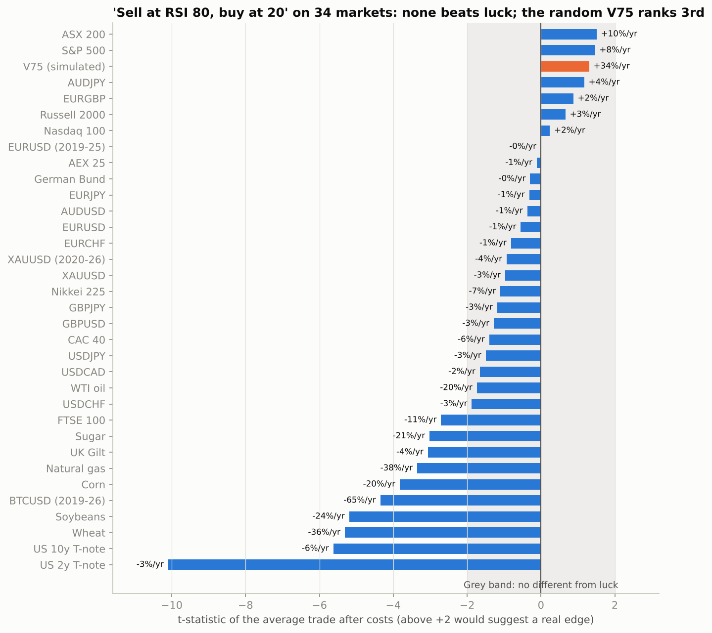

# 🌍 RSI 80/20 on 34 Markets: Where Does It Work Best?

A trader's MT5 rule, tested on every market with free 15-minute data:

> **M15 chart, RSI(14): SELL when RSI reaches 80, BUY when it reaches 20**, hold until the opposite signal (then flip), with a 3 × ATR safety stop.



## The verdict

**On no market does the rule beat luck.**
- The best result is the **ASX 200, with a t-statistic of 1.51**. When 34 markets are tested and none has a real edge, the best one typically scores about **2.1 by chance alone**.
- **The simulated V75**, a market made of pure random numbers, ranks **3rd** with "+34% a year". That's how big a lucky result can look.
- **10 markets lose significantly** (t below −2): all the farm commodities, natural gas, US and UK bonds, Bitcoin and the FTSE 100. Their spreads are too wide for a rule that trades about 80 times a year.

## Results by market

| Group | Markets | Avg edge per trade before costs | After costs | Best market |
|---|---|---|---|---|
| Stock indices | 8 | +4.3 bp | −0.8 bp | ASX 200 (t = 1.5) |
| Currencies | 12 | +0.7 bp | −1.4 bp | AUD/JPY (t = 1.2) |
| Gold | 2 | +0.3 bp | −4.3 bp | — |
| Bonds | 4 | 0.0 bp | −7.0 bp | — |
| Commodities | 6 | −9.6 bp | −36.6 bp | — |
| Bitcoin | 1 | −16.9 bp | −48.4 bp | — |
| *Random V75* | *1* | *+49.9 bp* | *+44.2 bp* | *(luck)* |

*1 bp = 0.01% of the price.*

**The closest to working,** each profitable in both halves of its history but still within luck range:

| Market | Period | Return/yr (unleveraged) | From sells at 80 | From buys at 20 |
|---|---|---|---|---|
| ASX 200 | 2015 – May 2020 | +10% | +28% total | +27% total |
| S&P 500 | 2015 – May 2020 | +8% | +11% | +35% (a rising market) |
| AUD/JPY | Nov 2012 – Mar 2022 | +4% | +18% | +15% |
| EUR/GBP | Nov 2012 – Mar 2022 | +2% | +8% | +7% |

On the ASX 200, AUD/JPY and EUR/GBP, sells and buys both made money while the market went nowhere. That's the profile of a mild short-term snap-back effect, if one exists. On the S&P 500 most of the profit came from buying dips in a rising market.

The rule's markets so far, **gold and V75**, both lose after costs.

## Data

All data is downloaded on demand from pinned commits; nothing is redistributed.

| Source | Markets | Period | Notes |
|---|---|---|---|
| [ejtraderLabs/historical-data](https://github.com/ejtraderLabs/historical-data) (Apache-2.0) | 11 FX pairs + gold, M15 | Nov 2012 – Mar 2022 | Prices stored ×100,000 / ×1,000 / ×100; rescaled. EUR/USD matches HistData to 2.4 pips (0.98 correlation of daily moves), gold matches the other archive to $0.74. |
| [FutureSharks/financial-data](https://github.com/FutureSharks/financial-data) (GPL-3.0, Oanda) | 8 stock indices, 6 commodities, 4 bonds, 1-minute | Jan 2015 – May 2020 | Rebuilt into M15 |
| This project's 1-minute sets | EUR/USD, gold, Bitcoin | 2019/2020 – 2025/2026 | See [`scalping/`](../scalping/), [`gold_rsi/`](../gold_rsi/), [`rsi_ichimoku/`](../rsi_ichimoku/) |
| [`v75_sim/`](../v75_sim/) | Deriv Volatility 75 | 4 simulated years | Random by construction |

**How it was tested:**
- **Fills:** entries fill at the next bar's open, and the stop counts first when a bar touches both stop and target.
- **Costs:** typical retail spreads, from 0.9 bp on EUR/USD to about 38 bp on sugar, plus yearly financing of 1% for FX and 4% for gold, indices, commodities and bonds. Results before costs are also reported.
- **Split:** each market's history is cut in half, and a result only counts if it holds in both halves.
- **Statistical test:** the t-statistic measures each market's average trade against its trade-to-trade variability.
- **Variations:** seven other versions of the rule (confirm entries, RSI-50 exits, ATR stops and targets) are in `results/all_markets.csv`. Only 11 of 272 market-and-version combinations (4%) were positive in both halves after costs.

## Limits

- **Stale data for stocks and commodities.** The index, commodity and bond data ends in May 2020, and the 12-market FX set in March 2022. I couldn't access recent intraday data for those markets here, so results after those dates are unknown.
- **Approximate costs.** Spreads are typical retail levels; your broker's may be higher or lower.

## Run it

```bash
python -m markets.lab       # downloads ~1.4 GB once, then 34 markets x 8 versions (~1 min)
python -m markets.report    # the chart above
python -m pytest tests/test_markets.py
```

> ⚠️ Research project, not financial advice.
