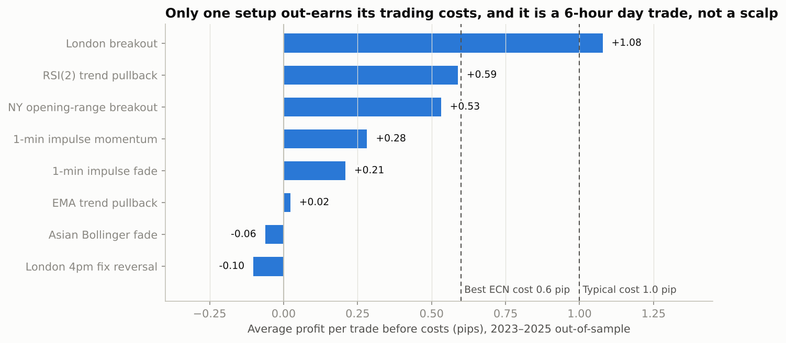
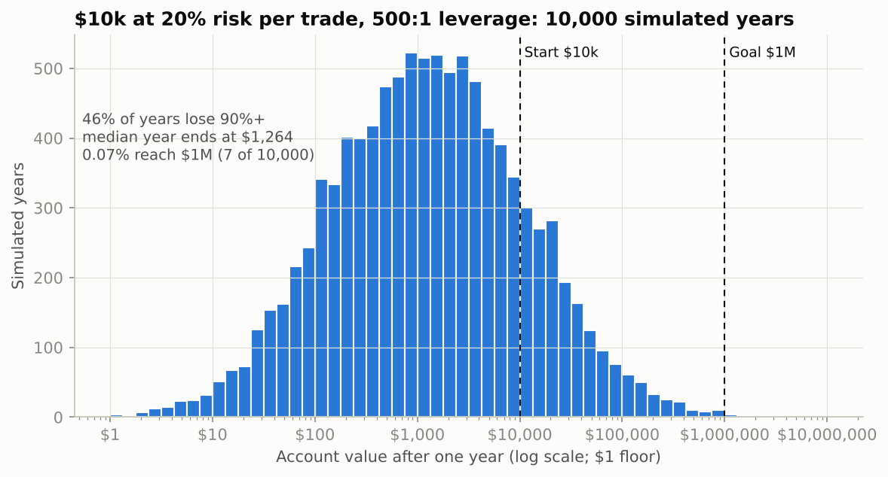

# ⚡ Scalping Lab: Can $10k Become $1M in a Year?

I set out to find 5 scalping strategies that could turn $10,000 into $1,000,000 in a year. The lab tested **8 classic EUR/USD scalping and intraday setups** on **2.6 million real 1-minute bars (2019–2025)** with realistic trading costs. It then simulated **10,000 possible years** of the best one at aggressive position sizes.

**Short answer:** none of the true scalps survived. The one setup with an edge isn't a scalp. And $1M happens in about **7 of 10,000** simulated years, about the same as a strategy that loses money.



## How the test was run

| | |
|---|---|
| **Data** | HistData EUR/USD 1-minute bid bars, 2019–2025: 2,553,973 bars, via the public mirror [asiertrades/HISDATA-EURUSD](https://github.com/asiertrades/HISDATA-EURUSD). 2023 is missing about six weeks. |
| **Tuning** | 822 parameter combinations, fitted on **2019–2022 only** |
| **Test** | Each strategy's best settings, run once on **2023–2025**, data it never saw |
| **Costs** | Per round trip: **0** (shows the raw edge), **0.6 pip** (best-case ECN spread + commission), **1.0 pip** (typical) |
| **Fills** | Entry at the next bar's open. If a bar touches both stop and target, the **stop counts first**. A gap through the stop fills at the gap price. |

## The 8 strategies

| # | Strategy | Idea |
|---|---|---|
| 1 | Asian Bollinger fade | Fade 2σ stretches in the quiet Tokyo session and target the mid band |
| 2 | London breakout | Trade the first break of the 00:00–07:00 London range |
| 3 | RSI(2) trend pullback | Buy sharp dips in an uptrend and sell rips in a downtrend |
| 4 | 1-min impulse momentum | Jump on an oversized 1-minute candle |
| 5 | 1-min impulse fade | Fade the same candle as an overreaction |
| 6 | NY opening-range breakout | Break of the 08:00–09:00 New York range |
| 7 | EMA trend pullback | Buy the dip to the 20 EMA in a stacked-EMA trend |
| 8 | London 4pm fix reversal | Fade the run into the WM/Reuters benchmark fix |

## Results: average pips per trade

| Strategy | Tuning years, 1.0 pip cost | **Unseen 2023–25, no cost** | Unseen, 0.6 pip | Unseen, 1.0 pip | Trades | Profit factor @0.6 |
|---|---|---|---|---|---|---|
| London breakout | +0.17 | **+1.08** | **+0.48** | **+0.08** | 389 | 1.04 |
| RSI(2) trend pullback | −0.13 | +0.59 | −0.01 | −0.41 | 636 | 1.00 |
| NY opening-range breakout | −0.06 | +0.53 | −0.07 | −0.47 | 362 | 0.99 |
| 1-min impulse momentum | −1.00 | +0.28 | −0.32 | −0.72 | 719 | 0.83 |
| 1-min impulse fade | −0.50 | +0.21 | −0.39 | −0.79 | 718 | 0.79 |
| EMA trend pullback | −0.80 | +0.02 | −0.58 | −0.98 | 1,152 | 0.93 |
| Asian Bollinger fade | +0.04 | −0.06 | −0.66 | −1.06 | 322 | 0.86 |
| London 4pm fix reversal | **+0.41** | −0.10 | −0.70 | −1.10 | 331 | 0.83 |

**What this shows:**

1. **Costs decide scalping.** The median 1-minute EUR/USD candle is only **1.1 pips** high to low, almost exactly the cost of one round trip. Even the best scalp, RSI(2) at +0.59 pips, only breaks even at the cheapest ECN price.
2. **Only 44 of 822 settings were profitable after costs, even on the data they were tuned on.** Pick the best of 822 and something will look good by luck.
3. **The in-sample winner failed.** The 4pm fix reversal was the best strategy on 2019–22 (+0.41 pips/trade) and lost on 2023–25 (−1.10). That is overfitting in one line.
4. **The survivor isn't a scalp.** The London breakout's median trade lasts **6.5 hours** with a **32-pip stop**. At 0.6 pip costs its edge is **+0.015R per trade**: a profit factor of 1.04 and an annual Sharpe of **0.17**.

## The $1M question



`million.py` replays the London breakout's real 2023–25 trades in random order, 130 trades per simulated year. Each trade risks a fixed share of the account, and the broker's leverage cap limits position size.

| Risk per trade | Leverage | Reach $1M | Lose 90%+ | Median year-end |
|---|---|---|---|---|
| 2% | any | 0% | 0% | $10,120 |
| 10% | 30:1 (EU/UK retail cap) | 0% | 1.6% | $7,406 |
| 20% | 30:1 | 0% | 2.5% | $6,979 |
| 10% | 500:1 | 0% | 4.2% | $6,470 |
| **20%** | **500:1** | **0.07%** | **46%** | **$1,264** |
| 50% | 500:1 | 0.01% | 99% | $0 |

The **NY breakout, RSI(2) pullback and 4pm fix reversal all lost money** out-of-sample. Even so, they reached $1M in 2–5 of 10,000 simulated years at extreme sizing. **Seeing someone turn $10k into $1M proves only that they survived, not that they had a skill.** Thousands of other accounts took the same risk and were wiped out.

### What it would take

At the growth-maximising bet size (Kelly), a year's log growth is about Sharpe² / 2. Multiplying money 100× (ln 100 ≈ 4.6) therefore needs an **annual Sharpe of √(2 · ln 100) ≈ 3.0**, however many trades you take. The best setup here manages 0.17. Even full Kelly at Sharpe 3 would mean living through huge drawdowns.

## Run it

```bash
pip install -r requirements.txt numba pyarrow
python -m scalping.lab        # downloads ~140 MB of M1 data once, then runs the tuning and the test (~3 min)
python -m scalping.million    # Monte Carlo of 10,000 years per strategy
python -m scalping.report     # charts
```

## Where scalping profits actually come from

Firms that do make money from scalping usually aren't predicting charts. They **earn the spread** as market makers, collect volume rebates, trade on speed (latency), or see order flow that retail traders can't see. A retail trader starts **1 pip behind on every trade**. The results above suggest a better direction is longer-horizon strategies, where a 1-pip cost is small next to the move, like the daily trend robot in this project.

> ⚠️ Research project, not financial advice. Leveraged FX can lose more than your deposit.
